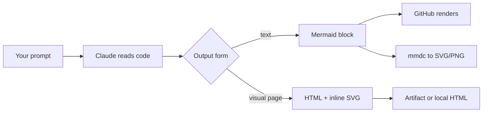
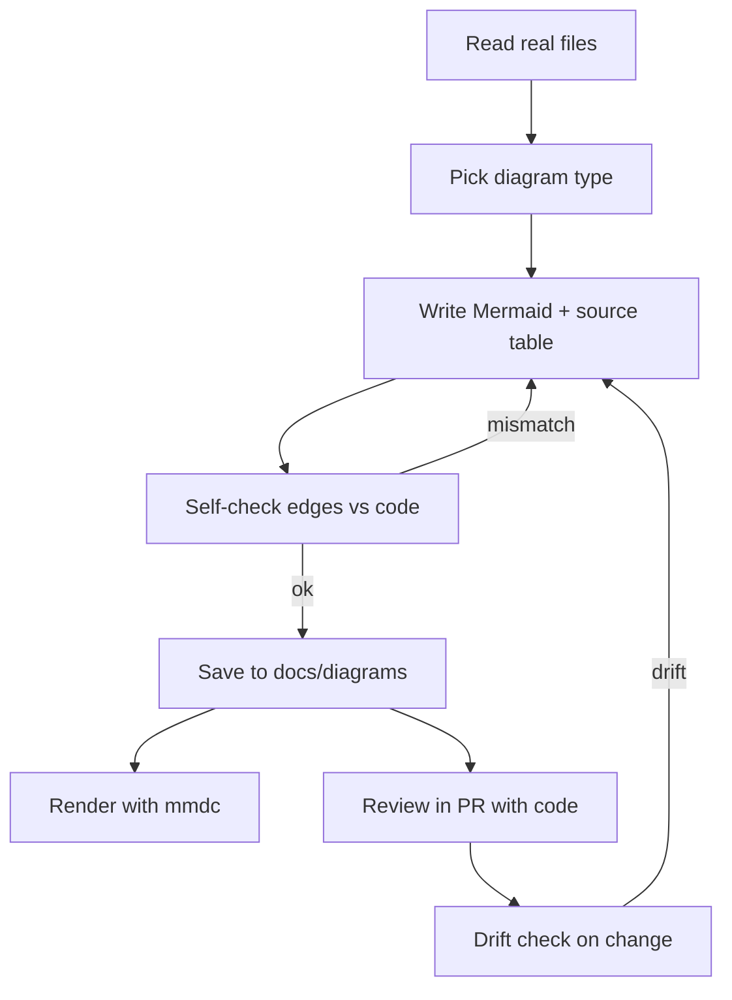
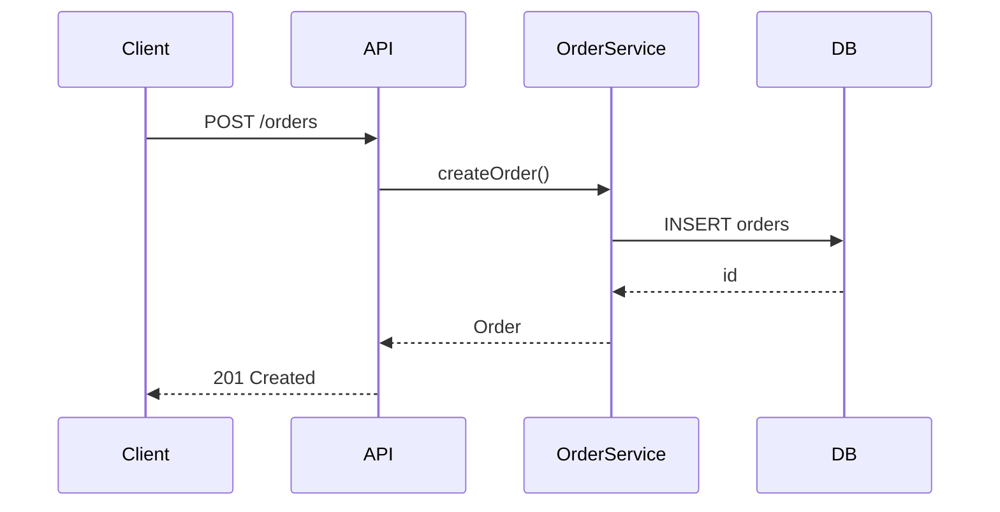
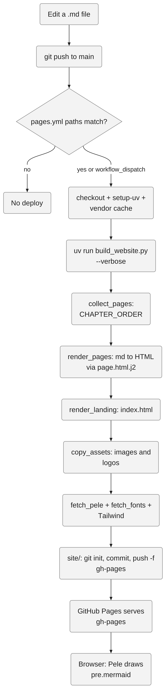
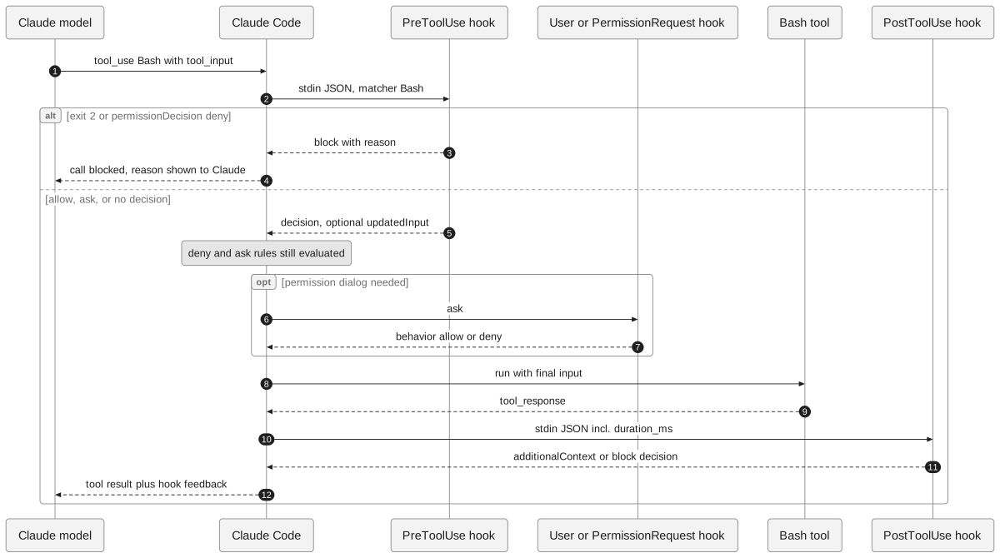
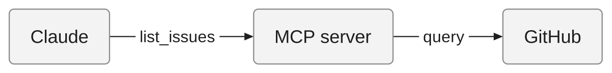
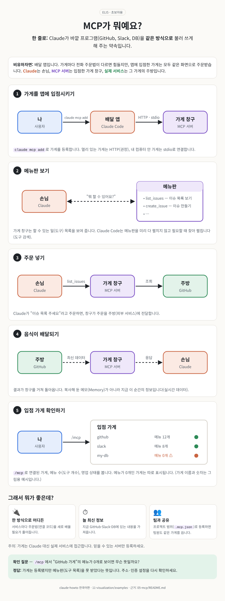
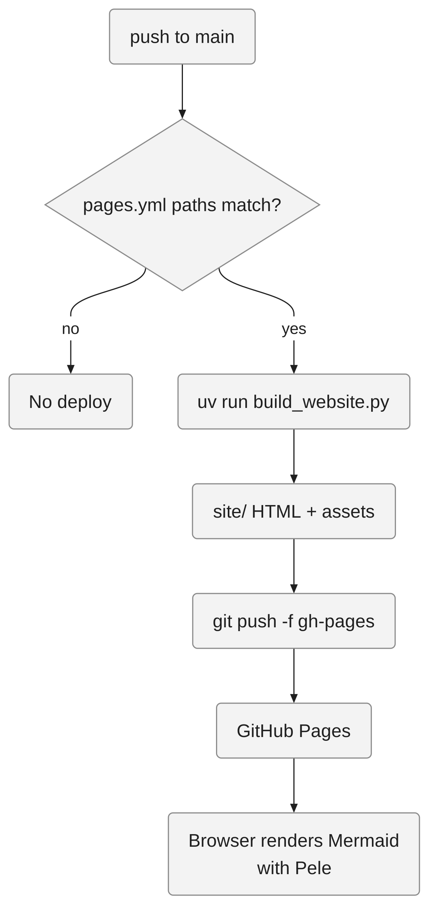

<!-- 한국어판 독자 모듈: 대응하는 영어 원문이 없습니다 -->
<!-- i18n-date: 2026-10-31 -->

<picture>
  <source media="(prefers-color-scheme: dark)" srcset="../resources/logos/claude-howto-logo-dark.svg">
  
</picture>

# 프로세스 시각화: 다이어그램과 ELI5

Claude Code가 코드베이스를 설명할 때 긴 문단 대신 **그림 한 장**이나 **아주 쉬운 비유(ELI5, Explain Like I'm 5)**로 보여 주게 만드는 방법을 다룹니다. 공식 기능(출력 스타일, 번들 스킬, 계획 모드)부터 커뮤니티 다이어그램·ELI5 스킬 비교, 코드와 어긋나지 않는 다이어그램을 만드는 실전 워크플로까지 정리하고, 이 모듈에서 바로 설치해 쓸 수 있는 스킬 2개와 출력 스타일 1개를 제공합니다.

> **참고**: 이 모듈은 한국어판에서 새로 작성한 독자 모듈입니다. 서드파티 스킬은 저자의 SKILL.md를 옮기지 않고 동작 방식만 요약했으며, 원문은 각 링크에서 확인하세요.

## 목차

1. [왜 시각화인가](#왜-시각화인가)
2. [시각화 작동 방식](#시각화-작동-방식)
3. [공식 기능](#공식-기능)
4. [다이어그램 스킬 비교](#다이어그램-스킬-비교)
5. [ELI5 스킬 비교](#eli5-스킬-비교)
6. [플러그인 마켓플레이스 빠른 참조](#플러그인-마켓플레이스-빠른-참조)
7. [실전 워크플로](#실전-워크플로)
8. [이 모듈의 예제 설치](#이-모듈의-예제-설치)
9. [사용 예](#사용-예)
10. [실제 예시](#실제-예시)
11. [문제 해결](#문제-해결)
12. [관련 모듈](#관련-모듈)

## 왜 시각화인가

글은 순서대로 읽어야 하지만 그림은 구조를 한눈에 보여 줍니다. 다음과 같은 경우에는 산문보다 다이어그램이나 ELI5가 낫습니다.

| 상황 | 산문의 한계 | 더 나은 형태 |
|------|-------------|--------------|
| 요청 하나가 여러 서비스를 거침 | "A가 B를 부르고, B는 다시…" 식으로 읽다가 길을 잃음 | `sequenceDiagram` |
| 분기·재시도·예외가 많은 제어 흐름 | 조건이 중첩될수록 문장이 길어짐 | `flowchart TD` |
| 테이블·엔터티 관계 | 외래 키 목록만으로는 전체 모양이 안 보임 | `erDiagram` |
| 주문·결제 같은 상태 전이 | 가능한 전이를 빠뜨리기 쉬움 | `stateDiagram-v2` |
| 처음 보는 개념을 비개발자·신입에게 설명 | 전문 용어가 진입 장벽이 됨 | ELI5(일상 비유 + 단계별 그림) |

반대로 한두 문장이면 충분한 내용, 노드가 2~3개뿐인 구조, 정확한 수치·설정값이 핵심인 내용은 그림이 오히려 방해가 됩니다. diagram-design 스킬도 그리기 전에 "문단 하나로 충분하지 않은가?"를 먼저 묻도록 권합니다.

## 시각화 작동 방식

Claude Code에서 다이어그램은 대부분 **텍스트(Mermaid)**로 만들어지고, 렌더링은 GitHub나 `mmdc` 같은 외부 도구가 담당합니다. HTML 아티팩트 계열 스킬은 인라인 SVG를 직접 그립니다.



| 형태 | 장점 | 단점 |
|------|------|------|
| Mermaid 텍스트 | diff·리뷰 가능, 코드 옆에 버전 관리 | 레이아웃 제어가 제한적 |
| HTML + 인라인 SVG | 보기 좋고 인터랙션 가능 | diff로 리뷰하기 어려움 |
| Excalidraw | 손으로 다시 편집 가능 | 별도 도구·렌더러 필요 |

> **주의**: Claude Code 터미널이 Mermaid를 그림으로 렌더링한다는 공식 문서는 확인되지 않았습니다(미확인). 터미널에서는 코드 텍스트로 보인다고 가정하고, 그림은 GitHub·`mmdc`·아티팩트로 확인하세요.

## 공식 기능

### 출력 스타일: Explanatory와 Learning

출력 스타일은 Claude가 **응답하는 방식**을 바꿉니다. 시각화·학습과 관련된 기본 제공 스타일은 두 가지입니다.

| 스타일 | 동작 |
|--------|------|
| **Explanatory** | 작업은 평소처럼 하면서, 대화 중에 2~3개 항목의 `★ Insight` 블록을 넣어 왜 그렇게 구현했는지 설명합니다(파일 주석이 아님) |
| **Learning** | Insight 블록에 더해, 실제 설계 결정이 필요한 코드를 `TODO(human)`로 남기고 "Learn by Doing" 요청(Context / Your Task / Guidance)을 보낸 뒤, 사용자가 작성한 코드에 Insight를 줍니다 |

전환 방법은 다음과 같습니다.

```bash
# 바로 전환 (v2.1.269+)
/output-style explanatory

# 메뉴에서 선택: Output style 항목
/config
```

설정 파일로 지정하려면 다음과 같이 씁니다. JSON 값은 대소문자를 구분합니다. 메뉴로 고르면 `.claude/settings.local.json`에 저장되며, 모든 프로젝트에 적용하려면 `~/.claude/settings.json`에 둡니다.

```json
{
  "outputStyle": "Explanatory"
}
```

VS Code에서는 `/` 메뉴 → Output styles에서도 고를 수 있습니다. 출력 스타일은 세션 시작 시 읽히므로 변경 후 `/clear`하거나 새 세션에서 적용됩니다.

> **참고**: 공식 마켓플레이스에는 `explanatory-output-style`, `learning-output-style` 플러그인(SessionStart 훅 주입 방식)도 있습니다. 해당 README는 이를 지원 중단(deprecated)·미출시로 표기하는 반면 현재 문서는 두 스타일을 기본 제공으로 나열하므로, 플러그인은 레거시 대안으로 보입니다. 기본 제공 스타일을 쓰세요.

### 사용자 지정 출력 스타일: 다이어그램 우선

매번 "다이어그램부터 그려 줘"라고 말하는 대신, 항상 Mermaid 다이어그램으로 시작하게 하는 출력 스타일을 만들 수 있습니다. 사용자 지정 스타일은 프런트매터가 있는 Markdown 파일이며 `~/.claude/output-styles/`(개인) 또는 `.claude/output-styles/`(프로젝트)에 둡니다.

| 프런트매터 | 용도 |
|------------|------|
| `name` | 스타일 이름(생략 시 파일 이름) |
| `description` | `/config` 선택기에 표시되는 설명 |
| `keep-coding-instructions` | `true`면 Claude Code의 기본 소프트웨어 엔지니어링 지침 유지 |
| `force-for-plugin` | 플러그인 스타일 전용: 플러그인 활성화 시 자동 적용 |

공식 문서의 예시도 바로 이 "Diagrams first" 스타일입니다(제어 흐름은 `flowchart TD`, 요청 경로는 `sequenceDiagram`, 노드 15개 미만). 이 모듈은 이를 확장한 [diagrams-first.md](output-styles/diagrams-first.md)를 제공합니다. 설치는 [이 모듈의 예제 설치](#이-모듈의-예제-설치)를 참고하세요.

### 번들 스킬: /dataviz와 /artifact-diagramming

설치 없이 쓸 수 있는 번들 스킬 중 시각화와 관련된 것은 다음과 같습니다.

| 스킬 | 하는 일 |
|------|---------|
| `/dataviz [request]` | 차트·그래프·대시보드 디자인 가이드. 차트 형태 선택, 역할별 색상 지정, 번들 스크립트로 팔레트의 색각 이상 안전성·대비 검증, 마크·인터랙션·접근성 규칙 적용. 브랜드 중립 플레이스홀더 팔레트를 자사 색으로 교체해 씁니다 |
| `/artifact-diagramming` | 아티팩트용 다이어그램 가이드(v2.1.221+). 언제 그림이 도움이 되는지, 무엇을 그릴지, 라이트·다크 모두에서 읽히는 인라인 SVG 작성법 |
| `/artifact-capabilities`, `/artifacts` | 아티팩트 런타임 기능 안내, 아티팩트 목록 보기·열기 |

아티팩트는 Pro/Max/Ultra/Team/Enterprise 플랜에서 `/login`이 필요하며 Anthropic API에서만 동작합니다(Bedrock/Vertex/Foundry 미지원). 조직 정책으로 꺼져 있을 수 있습니다. 번들 스킬 전체를 끄려면 `disableBundledSkills` 설정을 사용합니다.

### /insights와 기타 "보이는" 명령어

| 명령어 | 보여 주는 것 |
|--------|--------------|
| `/insights` | 최근 세션을 분석한 HTML 보고서(프로젝트, 사용량, 막혔던 지점, 써 볼 만한 기능). 클라우드 세션에서는 사용할 수 없습니다 |
| `/context` | 컨텍스트 사용량을 색깔 격자로 표시 |
| `/usage` (`/cost`, `/stats`) | 비용·플랜 한도·활동 통계 |
| `/statusline` | 세션 JSON(컨텍스트 %, 비용, git)을 stdin으로 받는 상태 표시줄 스크립트 구성 |

### 계획 모드를 시각적 계획으로 쓰기

계획 모드에서 Claude는 파일을 수정하지 않고 조사한 뒤 계획을 씁니다. 공식 문서는 계획 모드가 다이어그램을 그린다고 설명하지 않으므로, **계획 안에 Mermaid 다이어그램을 요청하는 것은 기능이 아니라 프롬프트 기법**입니다.

```bash
# 진입 방법 (택 1)
# 1) Shift+Tab 으로 권한 모드 순환
# 2) 슬래시 명령어
/plan 결제 재시도 로직을 리팩터링하는 계획을 세워 줘. 현재 흐름과 변경 후 흐름을 각각 Mermaid flowchart TD로 그려 줘
# 3) CLI 플래그
claude --permission-mode plan
```

계획이 나오면 `Ctrl+G`로 에디터에서 열어 다이어그램과 단계를 직접 고칠 수 있습니다. 항상 계획 모드로 시작하려면 설정에 `"permissions": { "defaultMode": "plan" }`을 둡니다. 자세한 내용은 [고급 기능의 계획 모드](../09-advanced-features/README.md#계획-모드)를 참고하세요.

## 다이어그램 스킬 비교

공식·커뮤니티 마켓플레이스에는 정확히 `design-diagram`이라는 이름의 스킬이 **없습니다**(claude-plugins-official, claude-community, claude-code-plugins-plus의 marketplace.json 기준). 가장 가까운 것은 `engineer-design-diagram`이며 명령어는 `/design:*`입니다. 이 모듈은 대신 직접 만든 [design-diagram 스킬](design-diagram/SKILL.md)을 제공합니다.

| 항목 | engineer-design-diagram | diagram-design | design-doc-mermaid | Excalidraw (yogsma) |
|------|------------------------|----------------|--------------------|---------------------|
| 출력 형식 | 다크 테마 HTML + 인라인 SVG(`.arch/`), 채팅에 Mermaid 동시 출력, 노드 50개 초과 시 Mermaid 폴백 | 자체 완결 HTML + 인라인 SVG(45종), SVG/PNG 내보내기 | Mermaid(flowchart, sequence, class, ER, state, C4), 설계 문서 Markdown, PNG/SVG | `.excalidraw` + `.svg` + 2x `.png` |
| 코드 근거 | 강함: 로드 시 셸 주입으로 manifest·의존성·compose 서비스·k8s·`*.tf` 수집 → 그래프 구성, 지문(fingerprint)으로 drift 감지 | 약함: 코드 근거보다 디자인 품질에 초점 | 중간: 프레임워크별 code-to-diagram 가이드, `mmdc` 검증 루프 | 중간: `diagram-from-code` 에이전트가 manifest·Docker·DB·HTTP·MQ 스캔 |
| 설치 | `/plugin marketplace add jeremylongshore/claude-code-plugins-plus-skills` → `/plugin install engineer-design-diagram@claude-code-plugins-plus` | `/plugin marketplace add cathrynlavery/diagram-design` → `/plugin install diagram-design@diagram-design` | `cd ~/.claude/skills && git clone https://github.com/SpillwaveSolutions/design-doc-mermaid.git` | `/plugin marketplace add yogsma/excalidraw-plugin` → `/plugin install excalidraw@yogsma-plugins` → `/reload-plugins` |
| 호출 | `/design:generate`, `/design:diff PR-123`, `/design:trace ./crash.log`, `/design:watch`, 자연어 | 자연어, `/diagram-design:import-mermaid`, `/export-diagram` | 자연어("activity diagram 만들어 줘") | `/excalidraw:draw <설명>`, `excalidraw:diagram-from-code` 에이전트 |
| 라이선스 | MIT | MIT | MIT(plugin.json·README 기준, 루트 LICENSE 파일 없음) | MIT |
| 추천 상황 | 실제 저장소 아키텍처를 자동으로 그리고 PR마다 구조 변화를 추적할 때 | 발표·문서용으로 디자인이 중요한 단발성 그림 | Git에 두고 계속 고치는 설계 문서 | 손으로 다듬어야 하는 화이트보드형 그림 |

설치 참고:

- **engineer-design-diagram**: 저장소 README는 `jeremylongshore/claude-code-plugins`로 추가하라고 하지만 실제 저장소 이름은 `claude-code-plugins-plus-skills`입니다. 이름 변경 리디렉션 여부는 확인되지 않았으므로 위 표처럼 실제 저장소 이름을 쓰는 편이 안전합니다.
- **diagram-design**: 스킬만 필요하면 `npx skills add cathrynlavery/diagram-design`도 됩니다. 첫 실행 시 브랜드 토큰을 묻는 스타일 가이드 단계가 있습니다. README 스스로 "스프린트마다 바뀌는 Git 문서에는 Mermaid가 더 적합하다"고 밝힙니다.
- **design-doc-mermaid**: 저장소에 marketplace.json이 없어 `/plugin marketplace add` 경로는 확인되지 않았습니다. git clone으로 설치하세요.
- **기타 Excalidraw 도구**: [edwingao28/excalidraw-toolkit](https://github.com/edwingao28/excalidraw-toolkit)(MIT)은 기존 `.excalidraw`를 요소 ID로 편집하고 코드 변경 후 단계적으로 갱신합니다. README에 따르면 npm `latest`(0.1.0)에는 이 워크플로가 없으므로 소스로 설치해야 합니다.
- **텍스트 Mermaid 전용**: [softaworks/agent-toolkit의 mermaid-diagrams](https://github.com/softaworks/agent-toolkit/tree/main/skills/mermaid-diagrams)(MIT)는 "어떤 질문에 어떤 다이어그램 유형"인지 고르는 가이드를 제공합니다. `npx skills add softaworks/agent-toolkit`로 설치합니다.

> **주의**: Kroki.io 기반 `diagrams` 플러그인처럼 다이어그램 소스를 외부 서비스로 보내는 도구는 사내 코드 구조가 외부로 나갈 수 있으므로 기업 환경에서는 검토 후 사용하세요.

## ELI5 스킬 비교

| 항목 | eli5 (커뮤니티 공식 미러) | pjerryhu/eli5-skill | DreambigOu/ELI5 | 이 모듈의 eli5 |
|------|---------------------------|---------------------|-----------------|----------------|
| 출력 | HTML 아티팩트(큰 그림, 적은 글) | 인라인 SVG가 들어간 단일 HTML 페이지(비공개 아티팩트, 불가하면 로컬 HTML) | 텍스트만(HTML·다이어그램 없음) | 한국어 Markdown + 단계별 작은 Mermaid, 선택적 HTML 아티팩트 |
| 기법 | 지침 한 줄 수준으로 최소화. 시각 품질은 Claude Code 자체 가이드에 맡기는 것으로 보임(추정) | 그림 우선, 모든 도형에 의미 부여. 한 문장 훅 → 번호 단계(제목+그림+캡션) → 요약. 쉬운 말 먼저, 용어는 괄호. 코드베이스 주제면 코드부터 읽음 | 청중 감지(나이·학년·직무·관계, 기본 5세) → 무엇/비유/세부/그래서 뭐 4단 구성. 평가 하네스 포함(README 기준 스킬 사용 83.3% vs 미사용 41.6%) | 한 줄 답 → 한국 일상 비유 → 3~5단계 그림 → "그래서 뭐가 좋은데?" → 확인 질문 1개 |
| 설치 | 아래 명령어 참고 | `git clone https://github.com/pjerryhu/eli5-skill ~/.claude/skills/eli5` | `git clone` 후 `cp -r` (아래 참고) | [이 모듈의 예제 설치](#이-모듈의-예제-설치) |
| 호출 | `/eli5 <주제>` | `/eli5 <주제>` | 자연어("ELI5 …", "매니저에게 설명해 줘") | `/eli5 <주제>` 또는 자연어 |
| 라이선스 | MIT | MIT | MIT | 이 저장소 라이선스 |

커뮤니티 eli5 설치(마켓플레이스 이름은 `claude-community`):

```bash
/plugin marketplace add anthropics/claude-plugins-community
/plugin install eli5@claude-community
```

DreambigOu/ELI5 설치:

```bash
git clone https://github.com/DreambigOu/ELI5.git
cp -r ELI5/skills/eli5 ~/.claude/skills/eli5
```

> **주의**: pjerryhu, DreambigOu, 이 모듈의 스킬은 모두 `~/.claude/skills/eli5`에 설치됩니다. 하나만 고르거나 디렉터리 이름을 바꿔 설치하세요(예: `~/.claude/skills/eli5-ko`). 디렉터리 이름이 곧 기본 스킬 이름입니다.

화면 전체를 시각 설명 페이지로 만들고 싶다면 [nicobailon/visual-explainer](https://github.com/nicobailon/visual-explainer)(MIT)도 있습니다. 아키텍처 설명·diff 리뷰·계획 리뷰를 ASCII 아트 대신 스타일이 적용된 HTML 페이지로 만들어 브라우저에서 엽니다(`/diff-review`, `/plan-review <file>`).

```bash
/plugin marketplace add nicobailon/visual-explainer
/plugin install visual-explainer@visual-explainer-marketplace
```

## 플러그인 마켓플레이스 빠른 참조

| 항목 | 공식 | 커뮤니티 |
|------|------|----------|
| 저장소 | `anthropics/claude-plugins-official` | `anthropics/claude-plugins-community` |
| 마켓플레이스 이름(`@` 뒤) | `claude-plugins-official` | `claude-community` |
| 추가 방법 | 첫 대화형 터미널 세션에서 자동 추가(관리형 정책 또는 `CLAUDE_CODE_DISABLE_OFFICIAL_MARKETPLACE_AUTOINSTALL`이 막지 않는 경우) | `/plugin marketplace add anthropics/claude-plugins-community` |
| 특징 | Anthropic 관리 | 매일 밤 동기화되는 읽기 전용 미러. claude.ai로 제출 → 보안 스캔·승인. 직접 PR은 자동 종료 |

```bash
# 세션 안에서
/plugin marketplace add <owner/repo>
/plugin install <plugin-name>@<marketplace-name>

# 셸에서 (동일 기능)
claude plugin marketplace add <owner/repo>
claude plugin install <plugin-name>@<marketplace-name>
```

마켓플레이스 소스로는 GitHub `owner/repo[#ref]`, 임의의 git URL, 로컬 경로(`./…`), 호스팅된 marketplace.json URL을 쓸 수 있습니다. `anthropics/claude-code` 안의 예전 `claude-code-plugins` 마켓플레이스는 지원 중단(deprecated)되었습니다. 자세한 내용은 [플러그인 마켓플레이스](../07-plugins/README.md#플러그인-마켓플레이스)를 참고하세요.

| 이 모듈에서 언급한 플러그인 | 마켓플레이스 추가 | 설치 |
|------------------------------|-------------------|------|
| eli5 | `anthropics/claude-plugins-community` | `eli5@claude-community` |
| engineer-design-diagram | `jeremylongshore/claude-code-plugins-plus-skills` | `engineer-design-diagram@claude-code-plugins-plus` |
| diagram-design | `cathrynlavery/diagram-design` | `diagram-design@diagram-design` |
| excalidraw | `yogsma/excalidraw-plugin` | `excalidraw@yogsma-plugins` |
| visual-explainer | `nicobailon/visual-explainer` | `visual-explainer@visual-explainer-marketplace` |

## 실전 워크플로

전체 흐름은 "코드 읽기 → 그리기 → 렌더링 → 커밋 → 검증"입니다.



### 코드베이스에서 Mermaid 다이어그램 만들기

아래 프롬프트는 커뮤니티 스킬의 기법(먼저 코드를 읽고, 근거를 남기는 방식)을 종합한 레시피이며 공식 문서 문구가 아닙니다. 경로는 자신의 프로젝트에 맞게 바꾸세요.

질문에 따라 다이어그램 유형을 고릅니다.

| 질문 | 다이어그램 |
|------|------------|
| 이 코드는 어떤 순서로 분기하나? | `flowchart TD` |
| 요청이 어떤 컴포넌트를 거치나? | `sequenceDiagram` |
| 데이터는 어떻게 연결되나? | `erDiagram` |
| 이 객체는 어떤 상태를 거치나? | `stateDiagram-v2` |

**시퀀스 다이어그램 레시피**:

```text
src/auth/ 아래 파일과 docker-compose.yml을 먼저 읽어 줘.
그다음 로그인 요청 하나가 처리되는 과정을 Mermaid sequenceDiagram으로 그려 줘.
규칙:
- 모든 participant와 메시지에 근거 file:line을 달아 줘(다이어그램 아래 표로).
- 코드에서 확인하지 못한 화살표는 그리지 말고 "미확인" 목록에 따로 적어 줘.
- participant는 8개 이하로.
```

**플로차트 레시피**:

```text
src/payments/retry.ts 의 processPayment 함수를 읽고
제어 흐름을 Mermaid flowchart TD로 그려 줘.
분기 조건은 코드의 실제 조건식을 짧게 줄여서 엣지 라벨로 쓰고,
노드는 15개 미만으로 유지해. 넘으면 하위 다이어그램으로 나눠 줘.
노드마다 file:line 표를 붙여 줘.
```

**아키텍처 레시피**:

```text
package.json(또는 pyproject.toml, go.mod), Dockerfile, docker-compose.yml,
k8s/ 디렉터리를 읽고 서비스 간 의존 관계를 Mermaid graph LR로 그려 줘.
외부 시스템(DB, 큐, 서드파티 API)은 subgraph로 묶고,
각 엣지가 어느 설정·코드에서 나왔는지 표로 정리해 줘.
```

작게 유지하세요. 공식 예시는 노드 15개 미만, diagram-design은 9개를 넘으면 나누라고 권합니다. 같은 프롬프트를 반복하고 있다면 [diagrams-first 출력 스타일](output-styles/diagrams-first.md)이나 [design-diagram 스킬](design-diagram/SKILL.md)로 고정하세요.

### mmdc로 SVG/PNG 렌더링

[mermaid-cli](https://github.com/mermaid-js/mermaid-cli)(MIT)의 `mmdc`로 Mermaid를 이미지로 변환합니다. Puppeteer/Chromium을 사용합니다.

```bash
# 설치
npm install -g @mermaid-js/mermaid-cli

# 단일 다이어그램
mmdc -i input.mmd -o output.svg
mmdc -i input.mmd -o output.png -t dark -b transparent

# 큰 PNG
mmdc --input input.mmd --size 4000 -o output.png

# Markdown 안의 모든 mermaid 블록을 SVG로 렌더링하고 링크로 바꾼 새 파일 생성
mmdc -i readme.template.md -o readme.md

# 전역 설치 없이
npx -p @mermaid-js/mermaid-cli mmdc -h

# Docker
docker run --rm -u `id -u`:`id -g` -v /path/to/diagrams:/data minlag/mermaid-cli -i diagram.mmd
```

### 다이어그램을 docs/에 두고 코드와 함께 리뷰

- `.mmd` 소스나 Mermaid 코드 블록이 든 `.md`를 `docs/diagrams/`에 커밋합니다. GitHub는 Markdown 파일·이슈·디스커션·PR·위키에서 Mermaid를 직접 렌더링하므로, PR에서 코드 diff와 다이어그램 diff를 함께 리뷰할 수 있습니다.
- Confluence·Notion·Word·PDF처럼 Mermaid를 렌더링하지 않는 곳에는 `mmdc`로 PNG/SVG를 함께 내보냅니다.
- GitHub Pages(Jekyll)에서의 렌더링은 테마에 따라 다르며 확인되지 않았습니다. 안전하게 하려면 `mmdc -i x.md -o x.md`처럼 미리 SVG로 렌더링해 두세요.
- HTML+SVG 스킬(diagram-design, engineer-design-diagram, eli5)의 결과물은 보기 좋지만 diff할 수 있는 텍스트 소스가 없습니다. 오래 유지할 문서에는 Mermaid를 우선하세요.

```text
docs/
└── diagrams/
    ├── login-sequence.md      # Mermaid 블록 + 근거 표
    ├── login-sequence.svg     # mmdc 렌더링 결과 (선택)
    └── services.md
```

### 다이어그램이 코드와 맞는지 검증

**문법 검증**: `mmdc`로 렌더링해 보면 문법 오류가 드러납니다. design-doc-mermaid는 Markdown 안의 블록을 추출해 검증하는 스크립트를 제공합니다.

```bash
# 렌더링이 실패하면 문법 오류
mmdc -i docs/diagrams/login-sequence.md -o /tmp/check.md
```

**의미 검증**: 노드·엣지마다 `file:line` 근거를 요구하고, Claude(또는 서브에이전트)에게 하나씩 다시 대조하게 합니다.

```text
docs/diagrams/login-sequence.md 의 근거 표를 한 줄씩 검증해 줘.
각 행에 대해 해당 file:line을 실제로 열어서
1) 그 위치에 정말 그 호출/의존이 있는지,
2) 화살표 방향이 맞는지 확인하고
결과를 OK / 틀림 / 위치 이동(새 file:line) 으로 표로 보여 줘.
다이어그램은 아직 수정하지 마.
```

**drift 검사**: 코드가 바뀐 뒤 다이어그램이 낡았는지 확인합니다.

```text
git diff main...HEAD 로 바뀐 파일 목록을 보고,
docs/diagrams/ 의 근거 표가 가리키는 file:line 중 바뀐 파일에 속한 항목을 찾아 줘.
각 항목이 여전히 유효한지 확인하고, 수정이 필요한 다이어그램만 갱신안을 제안해 줘.
```

자동화 도구도 있습니다. engineer-design-diagram의 `/design:watch`는 저장해 둔 그래프 지문과 현재 저장소를 비교하고, `/design:diff`는 PR의 구조 변화를 강조합니다. excalidraw-toolkit은 코드 변경 후 수동 편집을 보존하면서 단계적으로 갱신합니다. 편집 후 변경된 `.md`/`.mmd`에 `mmdc`를 돌리는 훅을 만들 수도 있지만, 이는 문서화된 레시피가 아니라 제안입니다([훅 가이드](../06-hooks/README.md) 참고).

## 이 모듈의 예제 설치

이 모듈은 다음 세 파일을 제공합니다.

| 파일 | 종류 | 설명 |
|------|------|------|
| [design-diagram/SKILL.md](design-diagram/SKILL.md) | 스킬 | 실제 파일을 읽고 근거 표와 함께 Mermaid 다이어그램을 만든 뒤 자체 검증 |
| [eli5/SKILL.md](eli5/SKILL.md) | 스킬 | 초보자용 한국어 설명: 한 줄 답, 일상 비유, 단계별 그림, 확인 질문 |
| [output-styles/diagrams-first.md](output-styles/diagrams-first.md) | 출력 스타일 | 설명할 때 항상 Mermaid 다이어그램부터 제시 |

저장소 루트에서 실행합니다.

```bash
# 개인 스킬로 설치 (모든 프로젝트)
mkdir -p ~/.claude/skills ~/.claude/output-styles
cp -r 11-visualization/design-diagram ~/.claude/skills/design-diagram
cp -r 11-visualization/eli5 ~/.claude/skills/eli5
cp 11-visualization/output-styles/diagrams-first.md ~/.claude/output-styles/

# 다른 eli5 스킬이 이미 있다면 이름을 바꿔 설치
# cp -r 11-visualization/eli5 ~/.claude/skills/eli5-ko
```

특정 프로젝트에만 적용하려면 대상 프로젝트 루트에서 경로를 바꿉니다.

```bash
mkdir -p .claude/skills .claude/output-styles
cp -r /path/to/claude-howto/11-visualization/design-diagram .claude/skills/
cp -r /path/to/claude-howto/11-visualization/eli5 .claude/skills/
cp /path/to/claude-howto/11-visualization/output-styles/diagrams-first.md .claude/output-styles/
```

출력 스타일 적용:

```bash
/output-style diagrams-first
# 또는 /config → Output style 에서 선택. 적용은 /clear 후 또는 새 세션부터
```

## 사용 예

```bash
# 아키텍처 다이어그램
/design-diagram 이 저장소의 서비스 구성도를 그려 줘

# 특정 흐름의 시퀀스 다이어그램
/design-diagram 주문 생성 API 요청이 DB까지 가는 과정

# 자연어로 자동 호출 (description 매칭)
결제 모듈 흐름을 다이어그램으로 보여 줘

# ELI5
/eli5 이 프로젝트의 캐시 무효화가 어떻게 동작하는지
/eli5 OAuth 토큰 갱신을 기획자에게 설명하듯이

# HTML 아티팩트로 (로그인 필요, Anthropic API 전용)
/eli5 쿠버네티스 롤링 업데이트를 HTML 페이지로
```

design-diagram이 만드는 결과의 모양은 다음과 같습니다(예시).



| 요소 | 근거 |
|------|------|
| `C->>A: POST /orders` | `src/routes/orders.ts:12` |
| `A->>S: createOrder()` | `src/routes/orders.ts:18` |
| `S->>D: INSERT orders` | `src/services/order.ts:41` |

> **헤드리스(`claude -p`)로 실행할 때**: 이 모듈의 `design-diagram` 스킬은 프런트매터에 `allowed-tools`가 있어서, `claude -p`에서는 스킬 호출 자체를 허용해야 합니다. 허용하지 않으면 `Error: Execute skill: design-diagram`이 나고 Claude가 SKILL.md를 직접 읽어 흉내 냅니다(Claude Code 2.1.314에서 확인).
>
> ```bash
> claude -p "이 앱에서 주문 생성 요청이 처리되는 흐름을 다이어그램으로 그려줘" \
>   --permission-mode acceptEdits --allowedTools Skill
> ```
>
> 대화형 세션에서는 권한 확인 창에서 허용하면 됩니다.

## 실제 예시

위 사용 예는 결과의 "모양"만 보여 줍니다. 아래는 이 모듈의 스킬을 **이 저장소에 실제로 적용해 만든 결과물**입니다(예시 1~4). 예시 5는 각 출력 스타일의 문서화된 동작에 맞춰 직접 쓴 예시 응답이며, 실제 세션을 캡처한 것은 아닙니다. 모든 Mermaid 다이어그램은 PNG로도 렌더링해 두었고, 각 예시 파일에는 그림 아래에 Mermaid 원본이 있습니다.

### 예시 1: Markdown 변경이 웹사이트가 되기까지(design-diagram)

`.github/workflows/pages.yml`과 `scripts/build_website.py`를 읽고 그린 `flowchart TD`입니다. 노드 14개마다 `path:line` 근거가 있고, 엣지별 검증 결과와 미확인 목록까지 스킬 출력 형식 그대로 담았습니다. 시퀀스 다이어그램 버전도 함께 있습니다.



전체 결과: [examples/design-diagram-site-pipeline.md](examples/design-diagram-site-pipeline.md)

### 예시 2: 도구 호출 하나의 훅 수명 주기(design-diagram)

`Bash` 호출 하나가 PreToolUse → 권한 확인 → 도구 실행 → PostToolUse를 거치는 `sequenceDiagram`입니다. 근거는 [훅 가이드](../06-hooks/README.md)의 줄 번호와 섹션 제목입니다.



전체 결과: [examples/design-diagram-hook-lifecycle.md](examples/design-diagram-hook-lifecycle.md)

### 예시 3: "MCP가 뭐야?"(eli5, Markdown)

`/eli5 MCP가 뭐야? 초보자한테 설명해줘`의 결과입니다. 배달 앱 비유 하나로 한 줄 답 → 비유 → 5단계 그림 → 그래서 뭐가 좋은데? → 확인 질문을 이어 갑니다. 사실관계는 [MCP 가이드](../05-mcp/README.md)에 맞췄습니다.



전체 결과: [examples/eli5-mcp.md](examples/eli5-mcp.md)

### 예시 4: "MCP가 뭐야?"(eli5, HTML 페이지)

같은 설명을 그림 위주의 자체 완결 HTML 페이지로 만든 버전입니다. 단계마다 큰 인라인 SVG와 짧은 캡션만 둡니다.



전체 결과: [examples/eli5-mcp.html](examples/eli5-mcp.html)

### 예시 5: 출력 스타일 비교(예시 응답)

"이 저장소에서 사이트는 어떻게 배포돼?"를 기본, Explanatory(`★ Insight`), 다이어그램 우선 스타일로 각각 답한 예시 응답입니다. 다이어그램 우선 스타일은 아래 그림으로 시작합니다.



전체 결과: [examples/output-style-comparison.md](examples/output-style-comparison.md)

## 문제 해결

### 빠른 참조

| 증상 | 원인 | 해결 |
|------|------|------|
| 터미널에 Mermaid 코드만 보임 | 터미널은 Mermaid를 렌더링한다고 확인되지 않음 | 파일로 저장 후 GitHub에서 보거나 `mmdc`로 렌더링 |
| `/output-style diagrams-first`가 목록에 없음 | 파일 위치·확장자 오류 | `~/.claude/output-styles/diagrams-first.md` 경로 확인, `/clear` 후 재시도 |
| 출력 스타일을 바꿨는데 그대로임 | 스타일은 세션 시작 시 읽힘 | `/clear` 또는 새 세션 |
| `/eli5`가 다른 스킬로 실행됨 | 같은 이름 스킬 중복 | 하나를 `eli5-ko` 등으로 이름 변경 |
| HTML 아티팩트가 안 만들어짐 | 미로그인, Bedrock/Vertex/Foundry 사용, 조직 정책 차단 | `/login` 확인, 안 되면 Markdown 모드 사용 |
| `/insights`가 안 됨 | 클라우드 세션 | 로컬 세션에서 실행 |
| `mmdc` 실행 시 Chromium 오류 | Linux 샌드박스·브라우저 문제 | mermaid-cli README의 Linux sandbox, 설치된 Chromium 사용 문서 참고 |
| 다이어그램이 코드와 다름 | 근거 없이 추측해 그림 | 근거 표 요구 + [검증 프롬프트](#다이어그램이-코드와-맞는지-검증) 실행 |

### 다이어그램이 너무 복잡함

노드가 15개를 넘으면 레벨을 나누세요. "전체 개요 1장 + 하위 영역별 상세" 구조로 요청하면 읽기 쉬워집니다. design-diagram 스킬은 이 규칙을 기본으로 따릅니다.

### Mermaid 문법 오류

라벨에 괄호·콜론·따옴표가 들어가면 깨지기 쉽습니다. 라벨을 `A["label (text)"]`처럼 큰따옴표로 감싸고, 렌더링 대상이 확실치 않으면 라벨을 영어·ASCII로 단순하게 유지하세요.

## 관련 모듈

- [에이전트 스킬 가이드](../03-skills/README.md) — 스킬 구조, [번들 스킬](../03-skills/README.md#번들-스킬)
- [고급 기능](../09-advanced-features/README.md) — [계획 모드](../09-advanced-features/README.md#계획-모드), [출력 스타일](../09-advanced-features/README.md#출력-스타일)
- [Claude Code 플러그인](../07-plugins/README.md) — [플러그인 마켓플레이스](../07-plugins/README.md#플러그인-마켓플레이스)
- [훅 가이드](../06-hooks/README.md) — 편집 후 자동 렌더링 같은 자동화

---

**최종 업데이트**: 2026년 10월 31일
**Claude Code 버전**: 2.1.310
**출처**:
- https://code.claude.com/docs/en/output-styles
- https://code.claude.com/docs/en/skills
- https://code.claude.com/docs/en/commands
- https://code.claude.com/docs/en/artifacts
- https://code.claude.com/docs/en/costs#analyze-your-usage-patterns
- https://code.claude.com/docs/en/statusline
- https://code.claude.com/docs/en/permission-modes#analyze-before-you-edit-with-plan-mode
- https://code.claude.com/docs/en/plugins/anthropic-marketplaces
- https://code.claude.com/docs/en/discover-plugins
- https://docs.github.com/en/get-started/writing-on-github/working-with-advanced-formatting/creating-diagrams
- https://github.com/mermaid-js/mermaid-cli
- https://github.com/anthropics/claude-plugins-community/tree/main/eli5/skills/eli5
- https://github.com/pjerryhu/eli5-skill
- https://github.com/DreambigOu/ELI5
- https://github.com/nicobailon/visual-explainer
- https://github.com/jeremylongshore/claude-code-plugins-plus-skills/tree/main/plugins/devops/engineer-design-diagram
- https://github.com/cathrynlavery/diagram-design
- https://github.com/SpillwaveSolutions/design-doc-mermaid
- https://github.com/softaworks/agent-toolkit/tree/main/skills/mermaid-diagrams
- https://github.com/yogsma/excalidraw-plugin
- https://github.com/edwingao28/excalidraw-toolkit
**호환 모델**: Claude Fable 5, Claude Opus 5, Claude Sonnet 5, Claude Sonnet 4.6, Claude Opus 4.8, Claude Haiku 4.5
