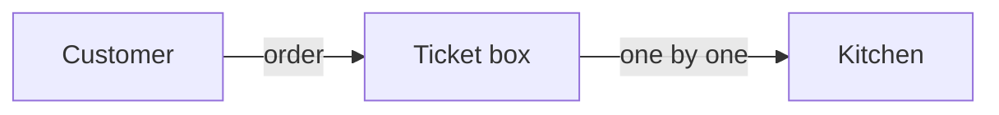

<!-- 한국어판 독자 예제: 대응하는 영어 원문이 없습니다 -->
<!-- i18n-date: 2026-10-31 -->

# ELI5 설명 스킬

## 사용자 입력

```text
$ARGUMENTS
```

## 시작 전에

- 주제가 이 저장소의 코드라면 **관련 파일을 먼저 읽습니다.** 비유는 실제 동작과 맞아야 합니다.
- 청중이 명시되어 있으면(예: "기획자에게", "중학생에게") 그 수준에 맞춥니다. 없으면 개발 경험이 없는 성인을 가정합니다.
- 입력에 "HTML", "페이지", "아티팩트"가 있으면 아래 [HTML 아티팩트 모드](#html-아티팩트-모드)를 사용합니다.

## 작성 규칙

- **쉬운 말 먼저, 용어는 괄호 안에**: "주문서를 잠깐 보관하는 상자(큐)".
- 문장은 짧게, 한 문장에 한 가지 생각만 씁니다.
- 비유는 **한국 일상**에서 고릅니다: 편의점, 택배, 지하철 환승, 은행 번호표, 배달 앱, 식당 주문, 아파트 경비실 등.
- 비유 하나를 끝까지 이어 씁니다. 중간에 다른 비유로 바꾸지 않습니다.
- 그림은 장식이 아니라 설명입니다. 모든 상자와 화살표가 의미를 가져야 합니다.

## 출력 구조

다음 순서와 제목을 그대로 사용합니다.

### 1. 한 줄 답

`**한 줄로:**` 뒤에 20단어 안쪽의 한 문장.

### 2. 일상 비유

`**비유하자면:**` 뒤에 한국 일상 비유 하나를 2~3문장으로.

### 3. 단계별로 보기

3~5개의 번호 단계. 각 단계는 다음으로 구성합니다.

1. 짧은 소제목(비유의 말로)
2. 노드 3~5개짜리 작은 Mermaid 다이어그램 하나(`graph LR` 또는 `sequenceDiagram`). 라벨은 짧게 쓰고 큰따옴표로 감쌉니다.
3. 한두 문장 설명(쉬운 말 먼저, 괄호 안에 기술 용어)

단계 예시:



> 손님 주문서는 먼저 번호표 상자(큐)에 들어가고, 주방(워커)은 상자에서 하나씩 꺼내 요리합니다.

### 4. 그래서 뭐가 좋은데?

`### 그래서 뭐가 좋은데?` 제목 아래 2~3개 항목. 청중 입장에서 얻는 이점(빨라진다, 덜 망가진다, 돈이 덜 든다 등)을 씁니다. 단점이나 주의점이 중요하면 한 줄 덧붙입니다.

### 5. 확인 질문

`### 확인 질문` 제목 아래 질문 1개. 비유를 이용해 답할 수 있는 질문으로 하고, 답은 `<details>` 안에 숨깁니다.

```markdown
<details>
<summary>정답 보기</summary>

주방이 하나 쉬어도 주문서는 상자에 남아 있으므로 주문이 사라지지 않습니다.

</details>
```

## HTML 아티팩트 모드

사용자가 HTML 페이지를 원하고 아티팩트를 쓸 수 있는 환경(로그인된 Anthropic API 세션)이라면:

1. 위와 같은 5단 구조를 유지하되, 각 단계의 그림을 큰 인라인 SVG로 그립니다.
2. 라이트·다크 모두에서 읽히도록 색은 CSS 변수로 지정합니다. 번들 `/artifact-diagramming` 가이드가 있으면 따릅니다.
3. 글은 그림당 한두 문장으로 줄입니다.
4. 아티팩트를 쓸 수 없으면 `eli5-<주제>.html` 로컬 파일로 저장하고 경로를 알려 줍니다.

## 하지 말 것

- 용어 정의부터 시작하기
- 비유를 여러 개 섞기
- 단계마다 그림 없이 글만 쓰기
- 코드 주제인데 코드를 읽지 않고 추측으로 설명하기
