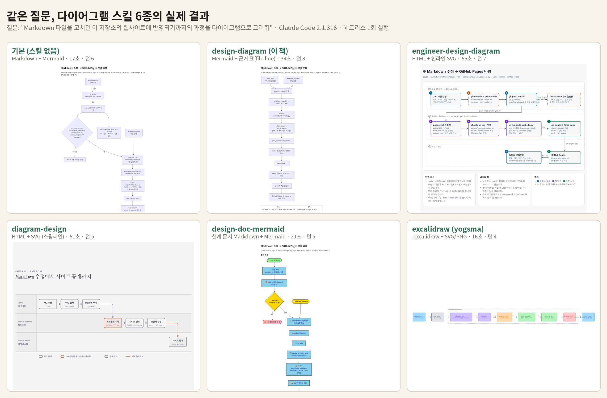
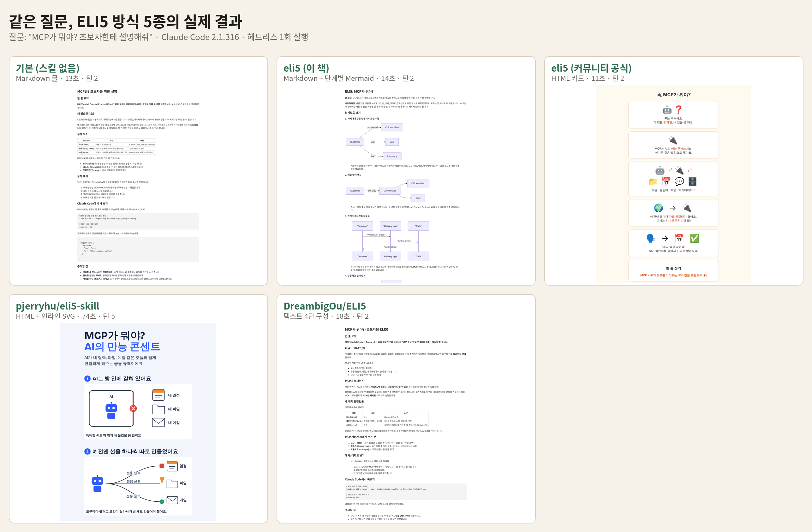

# 스킬별 결과 비교 (같은 질문, 실제 실행)

같은 저장소(이 저장소)에 같은 질문을 던지고, 다이어그램 스킬 6종과 ELI5 방식 5종을 각각 한 번씩 실제로 실행한 결과입니다.

- 실행: Claude Code 2.1.316, 헤드리스(`claude -p`), `--permission-mode acceptEdits --allowedTools Skill,Read,Glob,Grep,Write,Edit,Bash`
- 설치: 전역 `~/.claude`는 건드리지 않고, 실행 폴더의 `.claude/skills` 또는 `--plugin-dir`로만 불러옴 (`run.sh`)
- 1회 실행 결과이므로 실행할 때마다 모양과 내용이 달라질 수 있습니다.

## 다이어그램: "Markdown 파일을 고치면 이 저장소의 웹사이트(GitHub Pages)에 반영되기까지의 과정을 다이어그램으로 그려줘"

| 폴더 | 스킬 | 호출 |
|---|---|---|
| `diagram/0-baseline` | 스킬 없음 | 질문만 |
| `diagram/1-design-diagram` | 이 저장소의 [design-diagram](../../design-diagram/) | `/design-diagram` |
| `diagram/2-engineer-design-diagram` | jeremylongshore/claude-code-plugins-plus-skills | `/engineer-design-diagram:engineer-design-diagram` |
| `diagram/3-diagram-design` | cathrynlavery/diagram-design | `/diagram-design:diagram-design` |
| `diagram/4-design-doc-mermaid` | SpillwaveSolutions/design-doc-mermaid | `/design-doc-mermaid` |
| `diagram/5-excalidraw` | yogsma/excalidraw-plugin | `/excalidraw:draw` |

## ELI5: "MCP가 뭐야? 초보자한테 설명해줘"

| 폴더 | 스킬 | 호출 |
|---|---|---|
| `eli5/0-baseline` | 스킬 없음 | 질문만 |
| `eli5/1-eli5-this-book` | 이 저장소의 [eli5](../../eli5/) | `/eli5` |
| `eli5/2-eli5-community` | anthropics/claude-plugins-community의 eli5 | `/eli5:eli5` |
| `eli5/3-pjerryhu-eli5-skill` | pjerryhu/eli5-skill | `/eli5` |
| `eli5/4-dreambigou-eli5` | DreambigOu/ELI5 | `/eli5` |

소요 시간·턴 수는 `metrics.json`에 있습니다. 각 외부 스킬의 라이선스는 MIT입니다(각 저장소 기준).
