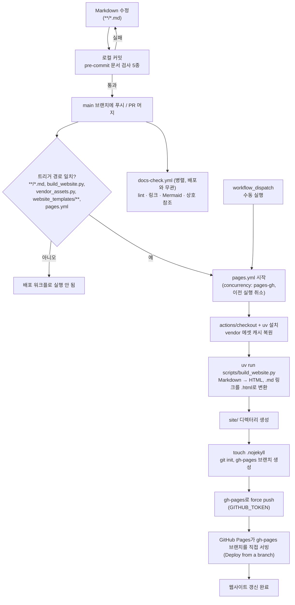

# Markdown 수정 → GitHub Pages 반영 과정

`.md` 파일을 수정해 `main`에 푸시하면 `.github/workflows/pages.yml`이 사이트를 빌드해 `gh-pages` 브랜치로 강제 푸시하고, GitHub Pages가 그 브랜치를 그대로 서빙합니다.

## 단계 설명

| 단계 | 내용 |
|------|------|
| 1. 수정·커밋 | pre-commit이 markdown-lint, cross-references, mermaid-syntax, link-check, markdown-rendering을 실행합니다. |
| 2. 푸시 | `main`에 푸시될 때만 배포됩니다. 경로 필터(`**/*.md` 등)에 해당해야 합니다. |
| 3. 빌드 | `scripts/build_website.py`가 Markdown을 유일한 원본으로 삼아 `site/`에 HTML을 생성합니다. |
| 4. 게시 | `site/`를 새 git 저장소로 만들어 `gh-pages`에 강제 푸시합니다. `actions/deploy-pages` 대기열을 쓰지 않습니다. |
| 5. 서빙 | Pages가 `gh-pages` 브랜치를 그대로 제공합니다. |

`docs-check.yml`은 같은 푸시에서 별도로 돌지만 배포를 막지 않습니다. 검사가 실패해도 `pages.yml`은 계속 진행됩니다.
