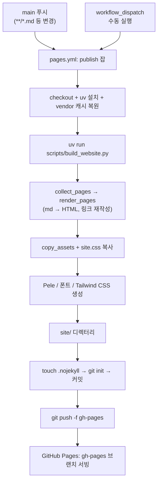

# Markdown 수정 → GitHub Pages 반영 흐름

`main`에 `.md` 변경이 푸시되면 `pages.yml`이 사이트를 빌드해 `gh-pages` 브랜치로 강제 푸시하고, Pages가 그 브랜치를 그대로 서빙합니다.

| 요소 | 근거 |
|------|------|
| `push` (main, `**/*.md` 및 빌드 스크립트·템플릿·워크플로 경로) | `.github/workflows/pages.yml:8-16` |
| `manual` (workflow_dispatch) | `.github/workflows/pages.yml:17` |
| `wf` (잡 `publish`, 동시 실행 시 이전 실행 취소) | `.github/workflows/pages.yml:22-29` |
| `prep` (checkout, uv, vendor 캐시) | `.github/workflows/pages.yml:31-42` |
| `build` | `.github/workflows/pages.yml:44-45` |
| `pages` (collect_pages → render_pages) | `scripts/build_website.py:1025`, `:1032` |
| `assets` (copy_assets, site.css 복사) | `scripts/build_website.py:1035`, `:1037-1042` |
| `vendor` (fetch_pele, fetch_fonts, build_tailwind_css) | `scripts/build_website.py:1049-1052` |
| `site` (`cd site`) | `.github/workflows/pages.yml:51` |
| `commit` (.nojekyll, git init, 커밋) | `.github/workflows/pages.yml:52-58` |
| `ghp` (강제 푸시) | `.github/workflows/pages.yml:59` |
| `serve` ("Deploy from a branch"로 gh-pages 직접 서빙) | `.github/workflows/pages.yml:3-5` (주석) |

## 미확인

- 저장소 Pages 설정(Settings → Pages)이 실제로 `gh-pages` 브랜치를 가리키는지: 워크플로 주석에만 근거가 있고 설정은 확인하지 못했습니다.
- `docs-check.yml`의 문서 검사가 배포를 막는지: `pages.yml`에는 의존 관계가 없어 그리지 않았고, 두 워크플로의 연동은 확인하지 못했습니다.
- 기본 `--lang`(`en`)에서 랜딩 페이지(`index.html`) 생성 여부: 워크플로는 옵션 없이 호출하며 `config.landing` 값은 확인하지 못했습니다.

생성일: 2026-10-31 · 기준 커밋: c755a99
