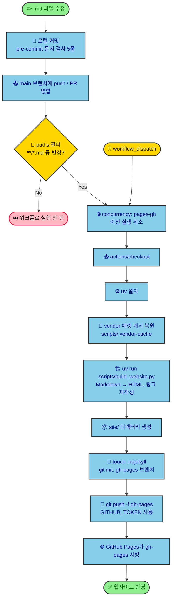
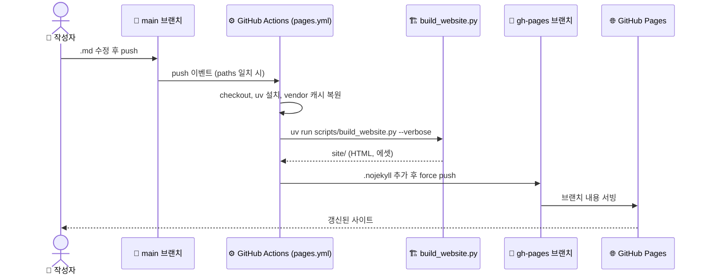

# Markdown 수정 → GitHub Pages 반영 과정

`.github/workflows/pages.yml` 기준입니다. Pages는 `gh-pages` 브랜치를 직접 서빙합니다("Deploy from a branch").

## 전체 흐름

## 시퀀스 보기

## 핵심 정리

| 항목 | 내용 |
|------|------|
| 트리거 | `main` push 중 `**/*.md`, `scripts/build_website.py`, `scripts/vendor_assets.py`, `scripts/website_templates/**`, `pages.yml` 변경, 또는 수동 실행 |
| 동시성 | `pages-gh` 그룹, 진행 중인 이전 실행은 취소 |
| 빌드 | `uv run scripts/build_website.py`, Markdown이 단일 소스이며 내부 `.md` 링크는 HTML로 재작성 |
| 배포 | `site/`를 새 git 저장소로 만들어 `gh-pages`에 force push (`.nojekyll` 포함) |
| 권한 | `contents: write` |
