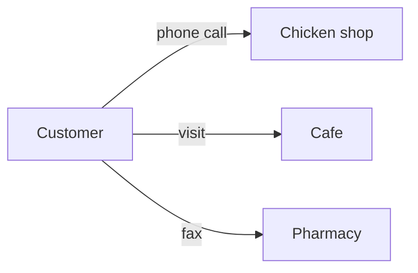
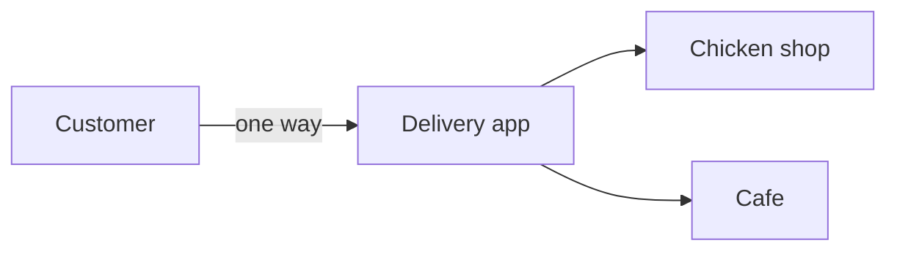
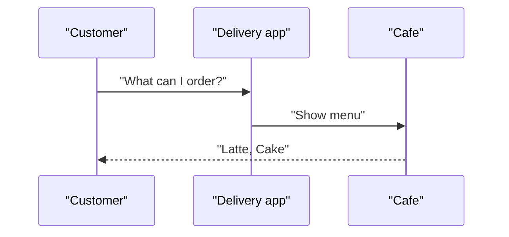
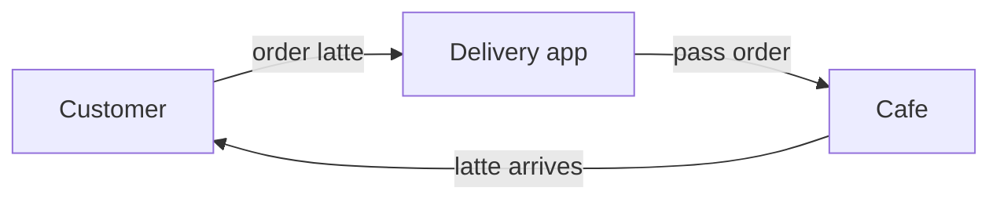

# ELI5: MCP가 뭐야?

**한 줄로:** MCP는 AI가 여러 프로그램과 자료를 똑같은 방식으로 이용하게 해 주는 공통 주문 방법입니다.

**비유하자면:** 배달 앱을 떠올려 보세요. 치킨집, 카페, 약국이 전화번호도 주문 방식도 제각각이어도, 우리는 앱 하나로 다 주문합니다. MCP는 AI에게 이런 배달 앱 같은 역할을 합니다. AI(손님)가 가게(도구)마다 따로 배우지 않아도 됩니다.

## 단계별로 보기

### 1. 가게마다 주문 방법이 다르던 시절

> 예전에는 손님이 가게마다 다른 방법으로 주문해야 했습니다. AI도 도구(파일, 메일, 데이터베이스)마다 연결 코드를 따로 만들어야 했습니다.

### 2. 배달 앱이 생김

> 손님은 앱의 주문 방식 하나만 알면 됩니다. 이 공통 약속이 MCP(Model Context Protocol, AI와 도구 사이의 표준 규칙)입니다.

### 3. 가게는 메뉴판을 내놓음

> 손님이 "뭐 주문할 수 있어?" 하고 물으면 가게가 메뉴판을 보여 줍니다. MCP 서버(도구를 제공하는 쪽)가 "할 수 있는 일 목록"을 AI에게 알려 주는 것과 같습니다.

### 4. 주문하고 결과 받기

> 손님이 주문하면 앱이 가게에 전달하고, 결과(커피)가 손님에게 돌아옵니다. AI(클라이언트)가 MCP로 도구를 호출하고 결과를 받는 흐름입니다.

### 그래서 뭐가 좋은데?

- **새 도구를 붙이기 쉬워집니다.** 가게가 앱에 입점하면 바로 주문할 수 있듯, MCP를 지원하는 도구는 금방 연결됩니다.
- **한 번 만들면 여러 AI에서 씁니다.** 가게가 앱에 한 번 등록하면 모든 손님이 주문할 수 있는 것과 같습니다.
- **주의:** 앱이 대신 주문하므로, 믿을 수 있는 가게(서버)만 연결하고 권한은 필요한 만큼만 주세요.

### 확인 질문

배달 앱에 새 가게가 입점했습니다. 손님은 그 가게를 주문하려면 새로운 주문 방법을 배워야 할까요?

정답 보기

아니요. 앱의 공통 주문 방식은 그대로이므로, 손님은 메뉴판만 보고 주문하면 됩니다. MCP도 새 도구가 생겨도 AI가 같은 방식으로 쓸 수 있습니다.

