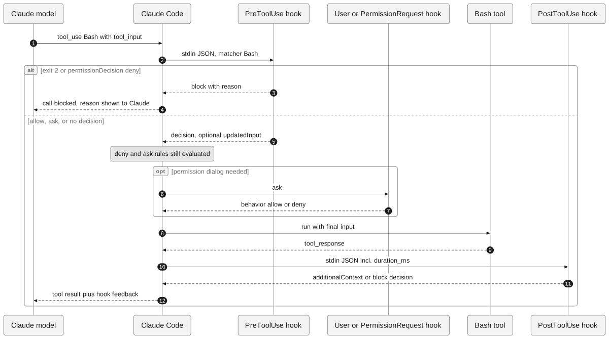
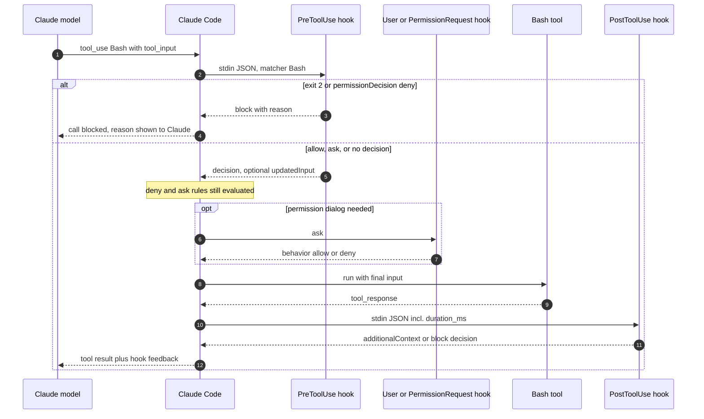

<!-- 한국어판 독자 예제: 대응하는 영어 원문이 없습니다 -->
<!-- i18n-date: 2026-10-31 -->

# 예시 2: design-diagram — 도구 호출 하나가 훅을 통과하는 순서

[design-diagram 스킬](../design-diagram/SKILL.md)로 만든 두 번째 결과입니다. 요청은 `/design-diagram Bash 도구 호출 하나가 PreToolUse, 권한 확인, 도구 실행, PostToolUse 훅을 거치는 순서`이고, 근거는 코드 대신 이 저장소의 [훅 가이드](../../06-hooks/README.md)입니다. 그래서 근거 표는 `file:line`과 함께 해당 섹션 제목을 적습니다.

## 무엇을 그렸나

Claude가 `Bash` 도구를 쓰기로 결정한 뒤 결과를 돌려받기까지, Claude Code가 훅을 어떤 순서로 부르고 각 훅의 응답에 따라 어디로 갈라지는지 보여 줍니다. "누가 누구에게 언제" 문제이므로 `sequenceDiagram`을 골랐습니다.

### Mermaid 원본

participant 6개, 메시지 12개입니다(번호는 다이어그램의 `autonumber`).

## 근거 표

| 요소 | 근거(`06-hooks/README.md`) |
|------|------------------------------|
| 순서: PreToolUse는 "도구 실행 전", PostToolUse는 "도구가 성공한 후" | `:267`, `:270` — [훅 이벤트](../../06-hooks/README.md#훅-이벤트) 표 |
| 1 `M->>CC`, 2 `CC->>Pre`: 매개변수를 만든 뒤 처리 전에 실행 | `:309` — [PreToolUse](../../06-hooks/README.md#pretooluse) |
| 2 매처 `Bash` | `:317`(구성 예시), `:74` — [매처 패턴](../../06-hooks/README.md#매처-패턴) |
| 2 stdin JSON(`hook_event_name`, `tool_name`, `tool_input`) | `:714`, `:722`–`724` — [JSON 입력(stdin)](../../06-hooks/README.md#json-입력stdin) |
| 3–4 `alt` 첫 분기: 종료 코드 2 = 차단 | `:755` — [종료 코드](../../06-hooks/README.md#종료-코드) |
| `alt` 첫 분기: `"deny"`는 도구 호출을 막음, 이유는 Claude에게 표시 | `:335`, `:339` — [PreToolUse](../../06-hooks/README.md#pretooluse) |
| 5 `else` 분기: allow / ask, `updatedInput` | `:333`–`336`, `:340` |
| Note: 훅 결과와 관계없이 deny·ask 규칙은 여전히 평가 | `:338` |
| 6–7 `opt` 권한 대화상자 → PermissionRequest 훅이 allow/deny | `:268` (이벤트 표), `:694`–`701` — [PermissionRequest 이벤트](../../06-hooks/README.md#permissionrequest-이벤트) |
| 8–10 도구 실행 후 PostToolUse | `:344` — [PostToolUse](../../06-hooks/README.md#posttooluse) |
| 10 `duration_ms` 포함 | `:373` |
| 11 `additionalContext` 또는 `"block"` 결정 | `:366`–`367` |

## 검증 결과

근거 표의 각 행을 `grep -n`으로 다시 열어 확인했습니다.

- 순서 PreToolUse → 도구 → PostToolUse: `:267`("도구 실행 전")과 `:270`("도구가 성공한 후")이 일치합니다. OK.
- 차단 분기: 종료 코드 2(`:755`)와 `deny`(`:335`) 둘 다 "작업 차단"입니다. 이유가 Claude에게 간다는 것은 `:339`("`"deny"`에서는 Claude에게 표시")와 맞습니다. OK.
- `"allow"`가 권한 프롬프트를 건너뛴다(`:334`)와 deny·ask 규칙은 여전히 평가된다(`:338`)를 함께 표현하려고 `opt`(선택적)로 그렸습니다. OK.
- PermissionRequest는 "권한 대화상자가 표시될 때" 실행됩니다(`:268`). 대화상자가 뜨지 않으면 이 단계가 없으므로 `opt`가 맞습니다. OK.
- PostToolUse의 `duration_ms`는 권한 프롬프트·PreToolUse 시간을 뺀 도구 실행 시간입니다(`:373`). OK.
- PostToolUse `"block"`은 "피드백과 함께 Claude에게 프롬프트를 보냅니다"(`:366`)이므로, 결과가 사라지는 것이 아니라 피드백이 붙어 돌아가는 화살표(12)로 그렸습니다. OK.

`검증: 메시지 12개와 분기 3개(alt, else, opt) 모두 06-hooks/README.md에서 확인, 미확인 1개`

## 미확인 목록

- **도구가 실패한 경우**: 실패 시에는 PostToolUse 대신 `PostToolUseFailure`(`:271`)가 실행되지만, 이 다이어그램은 성공 경로만 그렸습니다.
- **auto 모드 거부**: auto 모드가 호출을 거부하면 `PermissionDenied`(`:269`)가 실행됩니다. 권한 모드별 판단 순서는 훅 가이드에 자세히 나오지 않아 그리지 않았습니다(미확인).
- **여러 PreToolUse 훅**: 결정이 다르면 `deny` > `defer` > `ask` > `allow` 우선순위를 따릅니다(`:338`). 다이어그램은 훅 하나만 그렸습니다.

---

생성 날짜: 2026년 10월 31일 · 근거 문서: `06-hooks/README.md`(기준 커밋 `ecd7dfe`)
