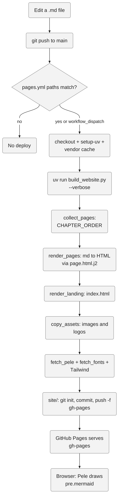
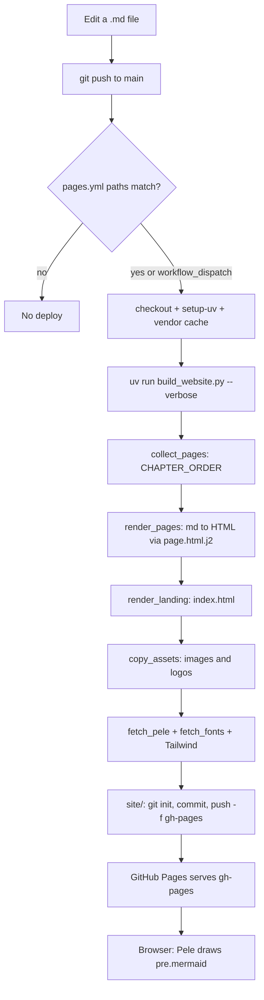
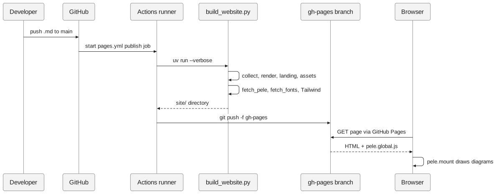
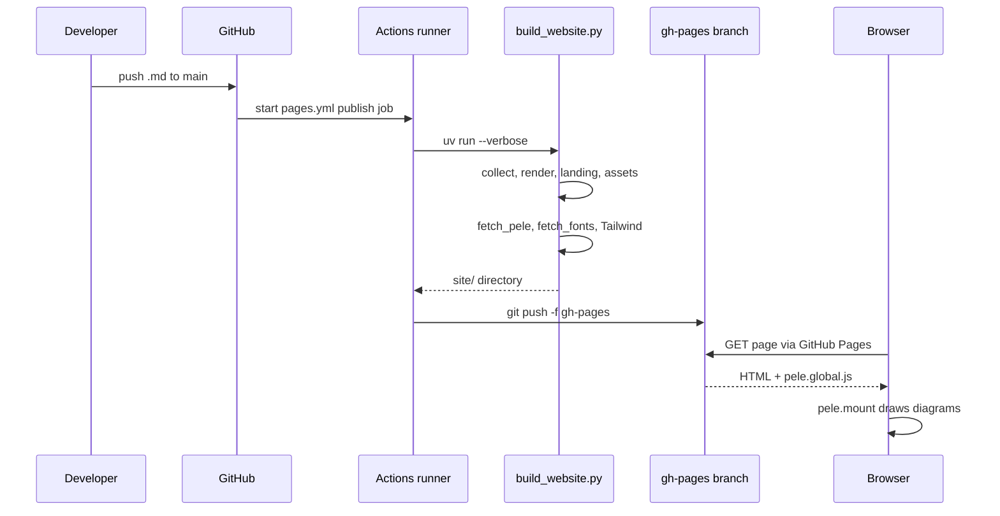

<!-- 한국어판 독자 예제: 대응하는 영어 원문이 없습니다 -->
<!-- i18n-date: 2026-10-31 -->

# 예시 1: design-diagram — Markdown 변경이 웹사이트가 되기까지

[design-diagram 스킬](../design-diagram/SKILL.md)을 이 저장소에 실제로 적용한 결과입니다. 요청은 `/design-diagram Markdown 파일을 고치면 웹사이트에 반영되기까지의 과정`이며, 스킬의 출력 형식(한 문장 → 다이어그램 → 근거 표 → 검증 요약 → 미확인 목록)을 그대로 따릅니다.

> **참고**: 그리기 전에 읽은 파일은 `.github/workflows/pages.yml`, `scripts/build_website.py`, `scripts/website_templates/page.html.j2`, `tools/promote_ko.py`, `tools/ko_site/pages.yml`입니다(1단계). 기준 커밋은 `study` 브랜치 `ecd7dfe`입니다.

## 무엇을 그렸나

`main`에 Markdown 변경이 푸시되면 GitHub Actions가 `scripts/build_website.py`로 `site/`를 만들고, 그 디렉터리를 `gh-pages` 브랜치로 강제 푸시해 GitHub Pages가 서비스하는 흐름입니다. 분기(트리거 조건)가 있는 파이프라인이므로 `flowchart TD`를 골랐습니다(2단계).

### Mermaid 원본

노드는 14개입니다(15개 미만 규칙 충족).

## 근거 표

| 요소 | 근거 |
|------|------|
| `push --> trig` (main 푸시가 트리거) | `.github/workflows/pages.yml:8`–`10` |
| `trig` 조건: `**/*.md`, 빌드 스크립트, 템플릿, 워크플로 자신 | `.github/workflows/pages.yml:11`–`16` |
| `trig -->` "workflow_dispatch" (수동 실행) | `.github/workflows/pages.yml:17` |
| `setup` (checkout, setup-uv, 캐시) | `.github/workflows/pages.yml:31`, `:34`, `:37` |
| `setup --> build` | `.github/workflows/pages.yml:45` |
| `build --> collect` | `scripts/build_website.py:1025` (`collect_pages` 호출), `:315` (`CHAPTER_ORDER` 순회) |
| `collect` 대상에 이 모듈 포함 | `scripts/build_website.py:131` (`("11-visualization", "프로세스 시각화")`) |
| `collect --> render` | `scripts/build_website.py:1032` |
| `render` 내부: Mermaid 펜스 → `<pre class="mermaid">` | `scripts/build_website.py:628`, `:564` |
| `render` 내부: 템플릿 렌더링 후 파일 쓰기 | `scripts/build_website.py:770`, `:837` |
| `render --> landing` | `scripts/build_website.py:1033`–`1034` (`config.landing`일 때), `:1141` (`landing=True`) |
| `landing --> assets` | `scripts/build_website.py:1035` |
| `assets` 내부: 이미지 복사 | `scripts/build_website.py:689` |
| `assets --> vendor` | `scripts/build_website.py:1049`, `:1050`, `:1052` |
| `vendor --> publish` | `.github/workflows/pages.yml:51`–`59` |
| `browser` (Pele로 Mermaid 그리기) | `scripts/website_templates/page.html.j2:203`, `:223`, `:240` |

## 검증 결과

4단계 자체 검증에서 근거 표의 모든 행을 `grep -n`으로 다시 열어 확인했습니다.

- `edit --> push`: 사람의 행동이므로 코드 근거 대상이 아닙니다(시작점).
- `push --> trig`: `pages.yml:10`이 `- main`입니다. OK.
- `trig -->|"no"| skip`: `paths:` 필터(`:11`–`16`)에 걸리지 않으면 워크플로가 실행되지 않습니다. OK.
- `trig -->|"yes or workflow_dispatch"| setup`: `:17`에 `workflow_dispatch:`가 있습니다. OK.
- `setup --> build`: `:45`가 `uv run scripts/build_website.py --verbose`입니다. OK.
- `build --> collect --> render --> landing --> assets`: `build_website()` 본문에서 `:1025` → `:1032` → `:1034` → `:1035` 순서로 호출됩니다. 화살표 방향과 순서 OK.
- `assets --> vendor`: `skip_vendor`가 거짓일 때만 `:1049`–`1052`가 실행됩니다. 워크플로는 `--skip-vendor` 같은 인수를 넘기지 않으므로(`:45`) 실행됩니다. OK.
- `vendor --> publish`: 빌드 단계(`:44`–`45`) 다음 단계에서 `cd site`(`:51`) 후 `git push -f ... gh-pages`(`:59`)입니다. OK.
- `publish --> serve`: 저장소 파일로는 Pages 설정을 볼 수 없어 주석(`pages.yml:4`)만 근거입니다. 아래 미확인 목록 참고.
- `serve --> browser`: `page.html.j2:240`에서 `pele.mount`를 호출합니다. OK.

`검증: 엣지 13개 중 11개 코드로 확인, 1개는 사람의 행동(시작점), 1개는 주석 근거만 있음(미확인)`

## 미확인 목록

- **Pages 소스 설정**: GitHub Pages가 `gh-pages` 브랜치를 "Deploy from a branch"로 서비스한다는 것은 `pages.yml:3`–`5`의 주석에만 있습니다. 저장소 설정 화면은 코드로 확인할 수 없습니다.
- **트리거 브랜치는 체크아웃마다 다릅니다**: 이 `study` 브랜치의 `pages.yml:10`은 `main`이지만, 한국어판 배포 브랜치 `ko`의 같은 줄은 `ko`입니다. `tools/promote_ko.py:329`–`332`가 `tools/ko_site/pages.yml`(`:10`이 `- ko`)을 워크플로 위치로 복사하기 때문입니다. 다이어그램은 지금 읽은 파일 기준으로 그렸습니다.

## 시퀀스로 본 같은 흐름(선택)

같은 흐름을 "누가 누구에게"의 관점으로 다시 그리면 다음과 같습니다. 각 메시지의 근거는 위 표와 같습니다.

### Mermaid 원본

---

생성 날짜: 2026년 10월 31일 · 기준 커밋: `ecd7dfe`(`study` 브랜치)
