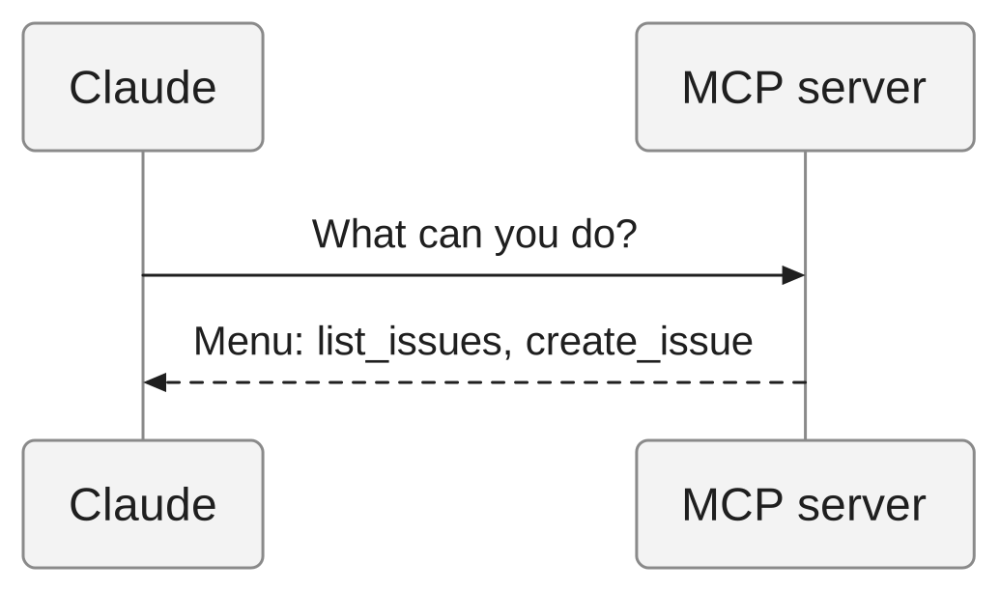
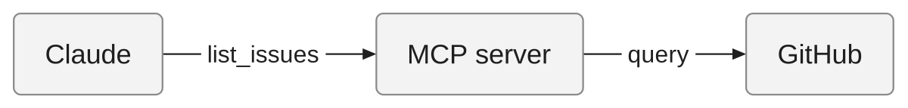
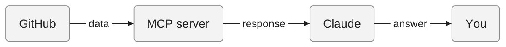
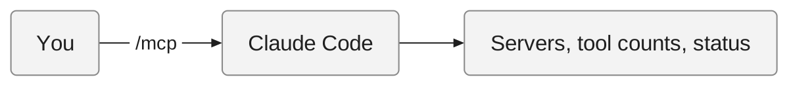
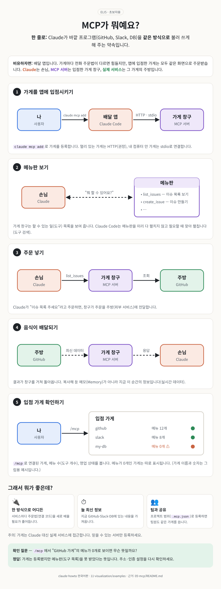
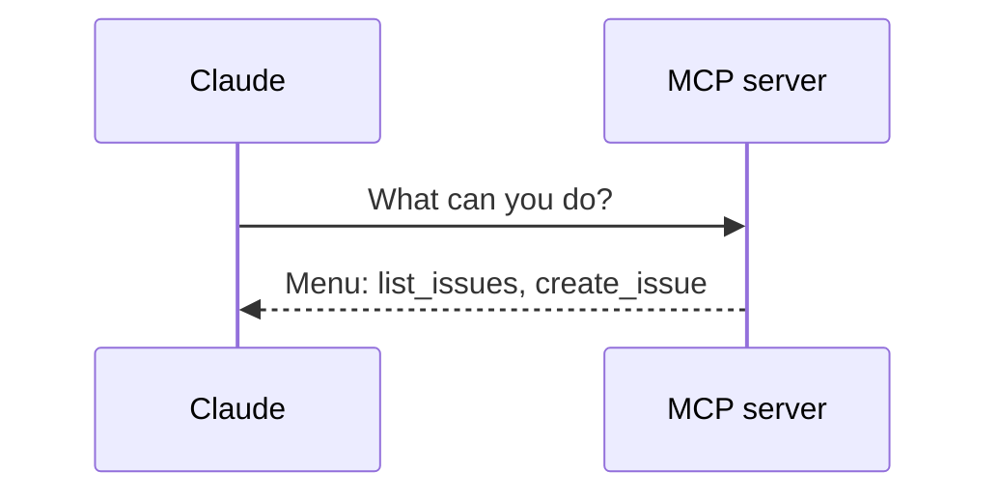

<!-- 한국어판 독자 예제: 대응하는 영어 원문이 없습니다 -->
<!-- i18n-date: 2026-10-31 -->

# 예시 3: eli5 — "MCP가 뭐야? 초보자한테 설명해줘"

[eli5 스킬](../eli5/SKILL.md)을 실제로 적용한 결과입니다. 요청은 `/eli5 MCP가 뭐야? 초보자한테 설명해줘`이며, 스킬의 5단 구조(한 줄 답 → 일상 비유 → 단계별 그림 → 그래서 뭐가 좋은데? → 확인 질문)를 그대로 따릅니다. 사실관계는 [MCP 가이드](../../05-mcp/README.md)에 맞췄습니다.

> **참고**: 스킬은 확인 질문의 답을 `
`에 숨기라고 하지만, 이 예시는 GitHub·위키독스·EPUB 어디서나 보이도록 일반 `정답:` 줄로 바꿨습니다. 그림의 원본 Mermaid는 문서 끝 [Mermaid 원본](#mermaid-원본)에 모았습니다. 같은 내용을 그림 위주 HTML 페이지로 만든 버전은 [eli5-mcp.html](eli5-mcp.html)입니다.

---

**한 줄로:** MCP는 Claude가 바깥 프로그램(GitHub, Slack, DB 등)을 같은 방식으로 불러 쓰게 해 주는 약속입니다.

**비유하자면:** 배달 앱과 같습니다. 가게마다 전화 주문 방법이 다르면 손님이 힘들지만, 배달 앱에 입점한 가게는 모두 같은 주문 화면으로 주문받습니다. Claude는 손님, MCP 서버는 배달 앱에 입점한 가게 창구, 실제 서비스는 그 가게의 주방입니다.

## 단계별로 보기

### 1. 가게를 앱에 입점시키기

> 먼저 "이 가게를 앱에 넣어 줘"라고 등록합니다(`claude mcp add`). 인터넷 너머 가게는 HTTP 방식(권장), 내 컴퓨터 안 가게는 stdio 방식으로 연결합니다.

### 2. 메뉴판 보기

> 가게 창구(MCP 서버)는 "우리는 이슈 목록 보기, 이슈 만들기를 할 수 있어요" 같은 메뉴판(도구 목록)을 보여 줍니다. Claude Code는 메뉴판을 처음부터 다 펼치지 않고, 필요할 때 찾아서 펼칩니다(도구 검색).

### 3. 주문 넣기

> Claude가 "이슈 목록 주세요(`list_issues`)"라고 주문하면, 가게 창구가 그 주문을 주방(외부 서비스, 예: GitHub)에 전달합니다.

### 4. 음식이 배달되기

> 주방이 만든 결과(데이터)가 창구를 거쳐 Claude에게 돌아옵니다. 메모(Memory)와 달리 지금 이 순간의 최신 정보입니다(실시간 데이터).

### 5. 입점 가게 확인하기

> 대화 중에 `/mcp`를 입력하면 어떤 가게가 연결됐는지, 메뉴가 몇 개인지(도구 개수), 문을 열었는지(연결 상태) 볼 수 있습니다.

### 그래서 뭐가 좋은데?

- **한 번 배우면 어디든 주문됩니다**: 가게마다 주문법을 새로 배울 필요가 없듯, 서비스마다 연결 코드를 따로 짤 필요가 줄어듭니다.
- **늘 최신 정보입니다**: 복사해 둔 메모가 아니라 지금 GitHub·Slack·DB에 있는 내용을 가져옵니다.
- **팀과 나눌 수 있습니다**: 프로젝트 범위로 등록하면(`.mcp.json`) 팀원도 같은 가게 목록을 씁니다. 처음 쓸 때 한 번 승인합니다.

주의: 가게(MCP 서버)는 Claude 대신 실제 서비스에 접근하므로, 믿을 수 있는 서버만 등록하세요.

### 확인 질문

배달 앱에 "GitHub 가게"를 입점시켰는데, `/mcp`에서 이 가게의 메뉴가 0개로 보인다면 무슨 뜻일까요?

정답: 가게는 등록됐지만 메뉴판(도구 목록)을 하나도 못 받았다는 뜻입니다. 즉 연결이나 설정이 잘못됐을 가능성이 크므로, 주소·인증 설정을 다시 확인해야 합니다(`/mcp`는 도구가 0개인 서버를 따로 표시합니다).

---

## HTML 아티팩트 버전

같은 설명을 스킬의 [HTML 아티팩트 모드](../eli5/SKILL.md#html-아티팩트-모드)로 만든 페이지입니다. 단계마다 큰 인라인 SVG 그림과 한두 문장 캡션만 두었고, 외부 리소스 없이 파일 하나로 열립니다. 원본: [eli5-mcp.html](eli5-mcp.html)

## 근거

| 내용 | 근거(`05-mcp/README.md`) |
|------|---------------------------|
| 한 줄 답: 외부 도구·API·실시간 데이터에 접근하는 표준화된 방법 | `:16` — [개요](../../05-mcp/README.md#개요) |
| 3·4단계: Claude → MCP Server → External Service → 응답 | `:27`–`41` — [MCP 아키텍처](../../05-mcp/README.md#mcp-아키텍처) |
| 1단계: `claude mcp add`, HTTP 권장 / stdio 로컬 | `:81`–`98` — [MCP 설치 방법](../../05-mcp/README.md#mcp-설치-방법) |
| 2단계: 도구 검색 기본 켜짐, 필요할 때 로드 | `:268` — [MCP 도구 검색](../../05-mcp/README.md#mcp-도구-검색) |
| 5단계·확인 질문: `/mcp`, 도구 개수, 0개 도구 표시 | `:261`, `:264` — [/mcp 명령어](../../05-mcp/README.md#mcp-명령어) |
| 이점: Project 스코프 `.mcp.json`, 첫 사용 시 승인 | `:362` — [MCP 스코프](../../05-mcp/README.md#mcp-스코프) |

## Mermaid 원본

1단계:

<!-- render: images/eli5-mcp-step1.png -->

2단계:

<!-- render: images/eli5-mcp-step2.png -->

3단계:

<!-- render: images/eli5-mcp-step3.png -->

4단계:

<!-- render: images/eli5-mcp-step4.png -->

5단계:

<!-- render: images/eli5-mcp-step5.png -->

