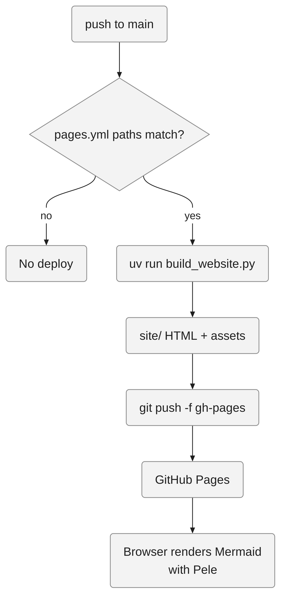
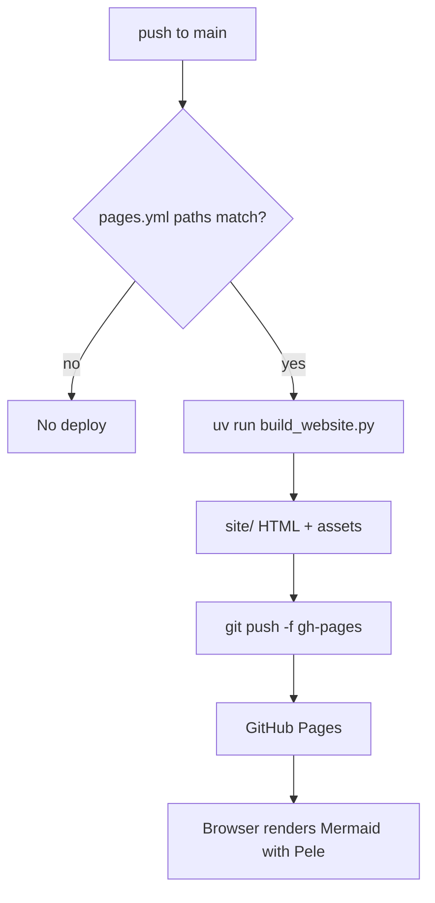

<!-- 한국어판 독자 예제: 대응하는 영어 원문이 없습니다 -->
<!-- i18n-date: 2026-10-31 -->

# 예시 5: 출력 스타일 비교 — 같은 질문, 세 가지 답

같은 질문을 출력 스타일 세 가지로 답하면 어떻게 달라지는지 보여 줍니다. 질문은 **"이 저장소에서 사이트는 어떻게 배포돼?"**입니다.

> **주의**: 아래 세 답은 **예시 응답**입니다. 실제 세션을 캡처한 트랜스크립트가 아니라, 각 스타일의 문서화된 동작([출력 스타일: Explanatory와 Learning](../README.md#출력-스타일-explanatory와-learning), [diagrams-first.md](../output-styles/diagrams-first.md))에 맞춰 직접 작성했습니다. 실제 응답은 모델·버전·대화 맥락에 따라 달라집니다. 사실관계는 [예시 1](design-diagram-site-pipeline.md)과 같습니다.

| 스타일 | 전환 방법 | 무엇이 달라지나 |
|--------|-----------|----------------|
| 기본(Default) | 설정 없음 | 짧고 직접적인 답 |
| Explanatory | `/output-style explanatory` | 답에 `★ Insight` 블록으로 "왜 이렇게 되어 있는지"를 덧붙임 |
| 다이어그램 우선 | `/output-style diagrams-first` | Mermaid 다이어그램 → 근거 표 → 짧은 설명 순서 |

## 기본(Default) 예시 응답

> `main`에 Markdown(`**/*.md`)이나 빌드 스크립트·템플릿이 바뀐 커밋이 푸시되면 `.github/workflows/pages.yml`이 실행됩니다. 이 워크플로는 `uv run scripts/build_website.py --verbose`로 `site/`를 만든 뒤, `site/`를 새 git 저장소로 초기화해 `gh-pages` 브랜치에 강제 푸시합니다. GitHub Pages는 그 `gh-pages` 브랜치를 그대로 서비스합니다. 수동 실행은 Actions 탭의 `workflow_dispatch`로 할 수 있습니다.

## Explanatory 예시 응답

> `main`에 Markdown이나 빌드 관련 파일이 바뀐 커밋이 푸시되면 `.github/workflows/pages.yml`이 실행되어 `scripts/build_website.py`로 `site/`를 만들고, 이를 `gh-pages` 브랜치에 강제 푸시합니다. GitHub Pages는 `gh-pages`를 서비스합니다.
>
> `★ Insight ─────────────────────────────────────`
>
> - **왜 `actions/deploy-pages`가 아닌가**: 워크플로 주석(`pages.yml:3`–`5`)에 따르면 `deploy-pages` 대기열이 느려서, `gh-pages` 브랜치에 직접 푸시하고 Pages를 "Deploy from a branch"로 설정했습니다.
> - **왜 매번 `git init`인가**: `site/`는 빌드 산출물이라 이력이 필요 없습니다. 새 저장소로 만들어 `push -f`하면 `gh-pages`에는 항상 최신 사이트 커밋 하나만 남습니다.
> - **Mermaid는 빌드 때 그리지 않습니다**: `build_website.py`는 Mermaid 블록을 `<pre class="mermaid">`로 바꿔 두기만 하고, 실제 그림은 브라우저에서 Pele가 그립니다(`page.html.j2:240`).
>
> `─────────────────────────────────────────────────`

## 다이어그램 우선 예시 응답

> **근거**
>
> | 요소 | 근거 |
> |------|------|
> | `push --> wf` | `.github/workflows/pages.yml:10`–`16` |
> | `wf --> build` | `.github/workflows/pages.yml:45` |
> | `build --> site` | `scripts/build_website.py:1032`–`1035` |
> | `site --> gh` | `.github/workflows/pages.yml:51`–`59` |
> | `browser` | `scripts/website_templates/page.html.j2:240` |
>
> 경로 필터에 맞는 푸시만 배포를 시작합니다. 빌드 결과 `site/`는 매번 새 커밋 하나로 `gh-pages`에 덮어써지고, Mermaid는 브라우저에서 그려집니다.

### Mermaid 원본

다이어그램 우선 스타일의 응답은 실제로는 아래 Mermaid 코드 블록으로 시작합니다. 위 그림은 이 블록을 렌더링한 것입니다.

## 비교 정리

| 관점 | 기본 | Explanatory | 다이어그램 우선 |
|------|------|-------------|----------------|
| 길이 | 가장 짧음 | 중간 | 중간(그림 + 표) |
| 강점 | 빠르게 답만 필요할 때 | 설계 이유를 배우고 싶을 때 | 구조를 한눈에 보고, 근거로 검증하고 싶을 때 |
| 근거 제시 | 경로 언급 정도 | Insight 안에 일부 | `file:line` 표가 기본 |
